  

<h2 align="center">Hi, I'm Aria Shokrollahi</h2>
<h3 align="center">UI/UX Designer &amp; Front-End Developer</h3>

  I design thoughtful digital experiences and turn ideas into clean, responsive interfaces.
   
  I enjoy connecting design and development to build products that are useful, clear, and enjoyable to use.

  <strong>I am the sun; my skills are the planets, and my projects orbit around curiosity.</strong>

---

## THE SUN — ABOUT ME

  
  
<strong>Aria Shokrollahi</strong> UI/UX Designer · Front-End Developer

- Designing user-centered interfaces and prototypes with **Figma**.
- Building responsive web experiences with **HTML, CSS, and JavaScript**.
- Creating and customizing websites with **WordPress and Elementor**.
- Exploring UX research, usability, design systems, and interaction design.
- Developing Windows desktop utilities with **C# and Windows Forms**.

## PROJECTS IN ORBIT

<table>
  <tr>
    <td width="50%" valign="top">
      <h3><a href="https://github.com/AriaShokrollahi/karman">Karman</a></h3>
      
A modern Persian landing page for an AI-powered compliance platform, focused on product storytelling and user experience.

      UI/UX · HTML · CSS · JavaScript · RTL
    </td>
    <td width="50%" valign="top">
      <h3><a href="https://github.com/AriaShokrollahi/TaskFlow">TaskFlow</a></h3>
      
A responsive Persian RTL dashboard concept for team projects, task tracking, progress summaries, and data visualization.

      Dashboard UI · HTML · CSS · JavaScript
    </td>
  </tr>
  <tr>
    <td width="50%" valign="top">
      <h3><a href="https://github.com/AriaShokrollahi/Auto-Theme-Switcher">Auto Theme Switcher</a></h3>
      
A Windows utility that schedules Light and Dark themes, switches wallpapers, and provides desktop clock widgets.

      C# · Windows Forms · Win32 API
    </td>
    <td width="50%" valign="top">
      <h3><a href="https://github.com/AriaShokrollahi/payamakino">Payamakino</a></h3>
      
A Persian SMS marketing product prototype with campaign interfaces, analytics dashboard, and an AI-assisted message-writing concept.

      Product UI · HTML · CSS · JavaScript
    </td>
  </tr>
</table>

## MY TOOLKIT

  

## CURRENTLY EXPLORING

- Improving JavaScript fundamentals and front-end development.
- Deepening UX research and usability testing skills.
- Building reusable components and scalable design systems in Figma.
- Creating polished web and desktop experiences.

## GITHUB ACTIVITY

  

  <a href="https://github.com/AriaShokrollahi">GitHub</a>
  &nbsp;·&nbsp;
  <a href="https://www.linkedin.com/in/aria-shokrollahi-143a682b9/">LinkedIn</a>
  &nbsp;·&nbsp;
  <a href="https://t.me/ariashokrollahi">Telegram</a>

  DESIGN WITH PURPOSE · BUILD WITH CURIOSITY · KEEP EXPLORING

